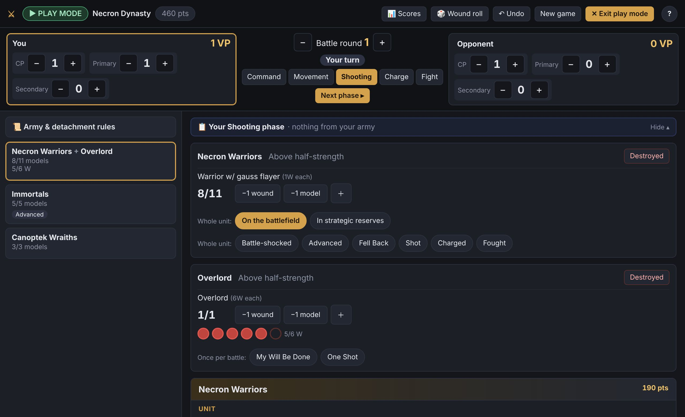

# NovaList – offline Warhammer 40,000 list builder

An offline army list builder and game companion for **Warhammer 40,000 (11th edition)**, using the community [BSData](https://github.com/BSData/wh40k-11e) army data. It runs entirely in your web browser – no installation and no internet connection needed.

## Features

- **Build lists** for every faction: units, wargear, Leaders, detachments (with Detachment Points and Force Disposition icons), enhancements and battle size, with the list checked against the rules as you go.
- **Datasheets** that show changes from wargear, enhancements, attached characters and detachments.
- **Play mode** for running a game on a laptop or tablet: CP/VP scoreboard and score by round, phases, wound tracking (including *Damaged* brackets applied to stat lines), unit markers, the Battle-shock step, phase reminders, strategic reserves and transports, a wound-roll reminder, and end of battle with overtime rounds.
- **Export and import** lists in the Warhammer 40,000 app / New Recruit text format, WTC format, and BattleScribe / New Recruit `.ros`/`.rosz` files. Print or save to PDF.
- **Data editor** (`editor.html`) for fixing points, stats, rules and options, and for adding new units and detachments.

## Getting started

1. Download this repository (**Code → Download ZIP**) and **extract** it – it won't work from inside the zip.
2. Double-click **`index.html`**. Chrome or Edge work best.
3. Press the **?** button in the program for the full illustrated user guide (`help.html`).

Your lists are saved in your web browser, not in the folder – use **Save file** to back them up or move them to another computer.

### Offline and on tablets

Opened from its web address (GitHub Pages), NovaList saves itself on the device the first time – the home screen shows **✓ Ready to use offline** – and then works with no internet. On Android use Chrome's **⋮ → Add to Home screen** to install it like an app.

## Folder layout

| Path | What it is |
| --- | --- |
| `index.html` | The list builder and play mode |
| `editor.html` | The data editor (needs Chrome or Edge to save) |
| `help.html`, `help/` | The user guide and its pictures |
| `js/`, `css/`, `icons/` | The program |
| `wh40k-11e-main/` | The BSData army data (`.json`) |
| `data/` | A copy of the army data prepared for the program – rebuilt automatically when you save in the data editor, or by running `build_data.py` |

## Updating the army data

Replace the `.json` files in `wh40k-11e-main/` with a newer BSData release and run `python build_data.py`, or open the folder in the data editor and save. Changes made with the data editor will be overwritten by a new BSData release, so keep a copy of edited files.

## Credits and disclaimer

Army data, points and rules text come from the community-maintained [BSData wh40k-11e](https://github.com/BSData/wh40k-11e) project. This is an unofficial fan project and is not endorsed by or affiliated with Games Workshop. Warhammer 40,000 and all associated names are trademarks of Games Workshop Ltd. The data may contain mistakes – check against your official rules.
